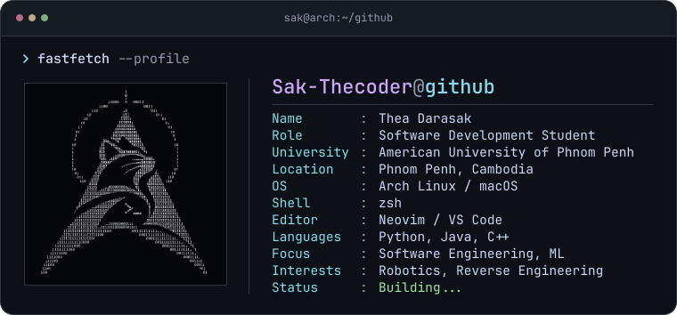

  

### `❯ ls ~/projects`

- [FixTrail](https://github.com/Sak-Thecoder/fixtrail-releases) — Cross-platform system diagnostics and troubleshooting.
- **Road Surface Quality Detection** — Computer vision and deep learning.
- **SraCash** — Android financial tracking application.
- [SentinelLog](https://github.com/Sak-Thecoder/SentinelLog) — Machine learning-based log risk classification.

### `❯ cat interests.txt`

Reverse Engineering · Machine Learning · Robotics · Games & Simulations · Systems Programming · Computer Vision

### `❯ cat contact.txt`

[GitHub](https://github.com/Sak-Thecoder) · [LinkedIn](https://www.linkedin.com/in/thea-darasak-a43216382/) · [Email](mailto:stardarasak@gmail.com)
